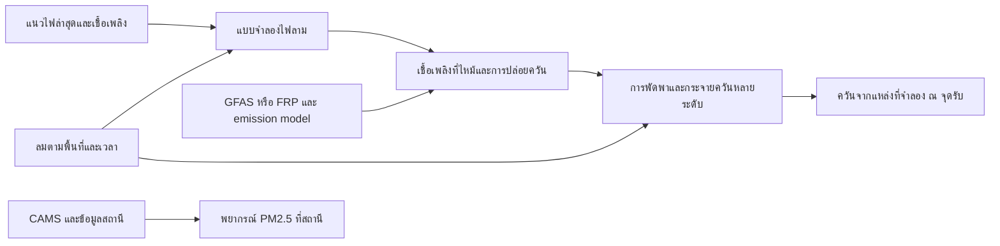

# แนวทางทำ prediction ของ ChiangMaiEyes ให้พร้อมทดสอบใช้งาน

ตรวจแหล่งข้อมูลวันที่ **17 ตุลาคม 2026 (ICT)** ข้อเสนอนี้ต่อจาก `output/hindcast-2026/RESULTS.md` และข้อจำกัดใน `docs/research/2026-10-15-spread-model-and-validation.md` เป็นงานวิจัยและการจัดลำดับงาน ยังไม่ได้เปลี่ยน solver, ติดตั้ง dependency, ขอสิทธิ์ข้อมูล หรือ deploy ฟีเจอร์ใหม่ในรอบนี้

## ข้อเสนอที่แนะนำ

ทำสองสายงานที่ตรวจผลได้แยกกัน: **พยากรณ์ PM2.5 รายสถานี 6/12/24 ชั่วโมง** และ **พยากรณ์การลามของไฟผิวดินเฉพาะเหตุที่มีแนวไฟเริ่มต้นและข้อมูลพื้นที่เพียงพอ** ระยะทดลอง 1/3/6 ชั่วโมง แล้วจึงเชื่อม emissions และ smoke transport ภายหลัง ช่วงเวลานี้เป็นขอบเขตผลิตภัณฑ์ที่เสนอ ไม่ใช่ช่วงเวลาที่ระบบปัจจุบันผ่านการรับรองแล้ว

สิ่งที่ต้องทำก่อนเปลี่ยนสมการคือสร้าง reference ของเหตุจริงตามเวลา เพราะการทดสอบเดิมเลือกวัน/ช่องที่หนาแน่นย้อนหลัง ใช้จุดแรกแทน ignition และนับจุดภายหลังในรัศมี 5 km ซึ่งอาจเป็นคนละเหตุหรือไฟที่ติดอยู่แล้ว **coverage 0.33% จึงไม่ใช่ accuracy และใช้เป็น objective จูนโมเดลไม่ได้** วงรีใหญ่ขึ้นอาจครอบจุดได้มากขึ้นโดยผิดพื้นที่มากกว่าเดิม

## 1. แปดแนวคิดที่ต่อกับระบบเดิมได้

| ลำดับ | แนวคิด | สิ่งที่ทำให้ดีขึ้น | สิ่งที่ต้องพิสูจน์/หาเพิ่ม |
|---|---|---|---|
| 1 | คลังเหตุที่มี event ID และ timeline | แยกการตรวจพบจากเหตุไฟจริง; รู้เหตุเริ่ม/แยก/รวม/ดับ | พิกัด/เวลาที่ตรวจยืนยัน; ขั้นตอนตรวจแก้การจัดกลุ่ม ไม่ใช้ระยะอย่างเดียวเป็นหลักฐาน |
| 2 | reference แนวไฟ/รอยไหม้หลายเวลา | มี target สำหรับเทียบตำแหน่งและพื้นที่ลามเพิ่ม | ภาพ Sentinel-2/HLS + QA/ผู้ตรวจ; หลักฐานภาคสนามตามเวลาสำหรับผลรายชั่วโมง |
| 3 | พยากรณ์ PM2.5 ด้วย CAMS + สถานี + local correction | เริ่มพิสูจน์ forecast ที่คนใช้ได้ก่อนระบบควันจากไฟครบ | historical access, station ID, QA, ช่วงเฉลี่ย, issue-time archive; เทียบ raw CAMS และ persistence |
| 4 | เชื้อเพลิงเป็นกริดที่อิงชนิดป่าและจุดสำรวจ | เปลี่ยนจาก FM1 สมมติเดียวทั้งพื้นที่เป็นข้อมูลท้องถิ่น | loading, depth, dead/live moisture และคุณสมบัติ fuel model; land cover/EVI เป็นตัวช่วยแบ่งกลุ่ม ไม่ใช่ kg/m² โดยตรง |
| 5 | ลมตามภูมิประเทศด้วย WindNinja | เพิ่ม spatial wind ในภูเขาแทนลมจุดเมืองเดียว | ทดสอบกับสถานีที่รู้ความสูง/ตำแหน่ง; แปลงสู่ midflame ตามเชื้อเพลิง/เรือนยอด ไม่ใช้ตัวคูณเดียวโดยไม่สอบเทียบ |
| 6 | ทดลอง engine กริดด้วย Pyretechnics | รองรับ fuel/terrain/wind/moisture เปลี่ยนตามพื้นที่และเวลา และเริ่มจาก burn scar | build/runtime benchmark, numerical regression, input units และทดสอบเหตุเชียงใหม่; มี library ไม่เท่ากับมี local accuracy |
| 7 | ปรับผลเมื่อมี observation ใหม่ + หลาย scenario | อัปเดตแนวไฟและเห็น sensitivity ของ inputs | ต้องเก็บ forecast เก่าไว้; scenario frequency ไม่ใช่ probability จนกว่าจะตรวจ calibration |
| 8 | emissions → smoke transport → receptors | เชื่อมไฟกับควันและฝุ่นที่ชุมชนได้รับ | emissions/injection height/ลมหลายระดับ/การตกสะสม; background และแหล่งนอกจังหวัด; สิทธิ์เผยแพร่ solver/data |

ลำดับการทำจริงเสนอ **1–3 ก่อน**, จากนั้น **4–7 ในพื้นที่ pilot**, แล้วจึง **8** ควบคู่กับการทดสอบเงียบที่ยังไม่ใช้ส่งแจ้งเตือนอัตโนมัติ

## 2. สร้างชุดเหตุและ reference ให้คะแนนได้

### ใช้สิ่งที่มีอยู่แล้ว

FIRMS 32,376 รายการของ ม.ค.–เม.ย. 2026 ใช้ค้นหา candidate events และเวลา overpass ได้ แต่ยังไม่ใช่ 32,376 labels ของแนวไฟ หรือ 32,376 เหตุที่อิสระจากกัน ชุดข้อมูลควรแยก `raw_detection`, `candidate_event`, `verified_event`, `observed_perimeter`, `estimated_perimeter`, `final_burn_scar` และมี provenance/คุณภาพต่อชิ้น

งาน FEDS ใช้การติดตาม fire objects ข้ามเวลาและการแยก/รวมกลุ่ม ไม่ปล่อยจุดทุกจุดเป็นเหตุอิสระ นำแนวคิดมาทดลองกับเชียงใหม่ได้ แต่ perimeter ที่อนุมานจาก VIIRS ต้องคงสถานะ estimate และห้ามใช้ perimeter ที่สร้างด้วยวิธีเดียวกับ predictor เป็น ground truth อิสระ [R1]

### ตรวจ catalogue จริงแล้ว

เรียก Copernicus Data Space STAC แบบอ่านอย่างเดียวรอบนี้ ในพื้นที่รอบ seed 3 กรณีวันที่ 28/29/30 มี.ค. 2026 ช่วง 20 มี.ค.–10 เม.ย. ได้ **4 ฉากต่อบริเวณ** ได้แก่ 26 มี.ค., 29 มี.ค., 3 เม.ย., 8 เม.ย. และไม่มี next page ของคำขอเหล่านั้น รายการฉากและค่า cloud cover ระดับ tile อยู่ใน `output/prediction-readiness-20261017/sentinel-catalogue-probe.json` ไม่ได้ดาวน์โหลด/แปลภาพเพื่อยืนยันรอยไหม้แล้ว และ cloud cover ของ tile ไม่รับรองว่าจุดเหตุไม่มีเมฆ/ควัน [R2]

นี่เป็นทางเริ่มทำ before/after burn-scar reference ด้วย NBR/dNBR และผู้ตรวจ แต่ช่วงห่างหลายวัน **ไม่ให้ reference แนวไฟรายชั่วโมง** ไม่ควรเอาขอบไฟวันที่ 3 เม.ย. มาเป็นแนวไฟจริงหลังเริ่มจำลอง 6 ชั่วโมง การมี final scar ช่วยประเมินพื้นที่สะสมในช่วงที่ตรงกัน ไม่ให้เวลาไฟมาถึงทุกจุด NASA HLS เป็นอีกช่องทางรวม Landsat/Sentinel; ต้องใช้เวลาสังเกตจริงและ QA ของฉากที่ได้ ไม่สมมติว่าความถี่เฉลี่ยของ constellation หมายถึงภาพใสทุกพื้นที่ [R3]

VNP64A1 เป็นผลิตภัณฑ์รอยไหม้รายเดือนกริด 500 m พร้อมวันไหม้และ uncertainty เหมาะตรวจความสอดคล้องภาพรวม/ค้นหาเหตุ ไม่ใช้เป็นตำแหน่งเปลวไฟรายชั่วโมงหรือรายละเอียดถนน/แนวกันไฟ 30 m [R4]

ถ้าต้องการ observation ถี่ขึ้น อาจเพิ่ม Himawari AHI เพื่อดูการเปลี่ยนของความร้อน เอกสาร NASA ระบุรอบสังเกต 10 นาทีและ nominal 2 km จึงใช้เป็นสัญญาณอัปเดตระดับกว้าง ไม่ใช้รับรองแนวไฟเล็กในป่าชุมชน ทั้งนี้ยังไม่ได้ตรวจช่องทาง API/archive ม.ค.–เม.ย. 2026 ของโครงการ; รุ่นดาวเทียม/ผลิตภัณฑ์ต้องตรวจตามช่วงเวลา ไม่ยึดชื่อ Himawari-8 ในบทความปี 2024 ไปอธิบายปี 2026 โดยอัตโนมัติ [R5]

**Pilot ที่เสนอ:** คัด 20–30 candidate events ที่มีภาพ/เจ้าหน้าที่ให้ตรวจต่อ เริ่ม 2–3 พื้นที่ที่หา reference ได้จริง จำนวนนี้เป็นขนาดงานตั้งต้น ไม่ใช่จำนวนที่รับรอง statistical power เมื่อคัดแล้วรายงานจำนวนเหตุที่มี reference เหลือจริงและช่วงลม/เชื้อเพลิงที่ครอบคลุม หากหา reference รายชั่วโมงไม่ได้ให้ลดความละเอียดของคำกล่าวอ้าง หรือคง fire product เป็น scenario ระหว่างเก็บ observation ล่วงหน้า

## 3. เลือก engine ที่เหมาะกับโค้ดของเรา

| ตัวเลือก | หลักฐาน | ข้อเสนอสำหรับโครงการ |
|---|---|---|
| **Pyretechnics** | ไลบรารี Python มี surface fire, fuel model, burn cells และ Eulerian level set; SpaceTimeCube รองรับ inputs ต่างมิติ/เวลา/ความละเอียด และคืน raster time of arrival [R6] | candidate แรกสำหรับ worker ของ backend Python; เริ่ม surface fire และตัดความสามารถที่ไม่มี input/validation ออก; ไม่เขียน solver ใหม่ทั้งหมด |
| **FARSITE ใน FlamMap** | USFS รองรับการเติบโตของไฟภายใต้ terrain/fuel/moisture/weather ที่ต่างกัน ต้องมี landscape layers และแอป desktop Windows 64-bit [R7] | ใช้เป็น reference workflow/เปรียบเทียบชุดเล็กก่อน ไม่สมมติว่า GUI เป็น server API ที่ติดตั้งแล้วเรียกได้ทันที หรือ LANDFIRE ของสหรัฐฯ ครอบคลุมไทย |
| โมเดลสถิติ daily spread potential | USFS research note ปี 2026 ใช้ข้อมูล 547 เหตุของสหรัฐฯ และ regression พยากรณ์โอกาสการลามรายวัน [R8] | ทางเลือกผลิตภัณฑ์สำหรับจัดลำดับพื้นที่ที่อาจลามมาก เป็นคนละงานกับวาดแนวไฟ 1 ชั่วโมง ต้องฝึก/ตรวจในเชียงใหม่ ไม่ใช้ coefficient สหรัฐฯ ตรง ๆ |

ตรวจ PyPI JSON สดได้ Pyretechnics **2026.8.10**, `requires_python=~=3.11`, มี source distribution ใน release ที่ตรวจ ไม่ใช่หลักฐานว่ามี Windows wheel หรือ build กับ environment ของเราแล้ว metadata อยู่ใน `output/prediction-readiness-20261017/pyretechnics-package-probe.json` แหล่งโค้ดระบุ EPL-2.0 ต้อง pin รุ่น/commit และรักษาเงื่อนไข license ตามรูปแบบ deploy ที่เลือก [R6]

**Architecture ที่เสนอ:** domain pilot ราว 10×10 km; ลองกริด 30/60/100 m เพื่อวัด runtime และผลไวต่อ resolution ก่อนเลือก ไม่ถือกริด 30 m ว่า accuracy 30 m รันใน background worker แยกจาก HTTP request; ส่ง GeoJSON/tiles/time-of-arrival raster ที่คำนวณแล้วให้เว็บเดิมอ่าน ขนาด domain/grid เป็นค่า benchmark ที่เสนอ ยังไม่มีผล runtime ของเครื่องนี้

DEM เดิมใช้ต่อได้สำหรับ preprocessing แต่ต้องอ่าน slope/aspect ณ ทุก cell ใน domain แทน median ของทั้งป่าหรือจุดตัวอย่างที่ไม่ใช่เหตุ ไฟต้องเริ่มจากตำแหน่ง/แนวไฟที่สังเกต ณ as-of; ถนน/ลำน้ำ/แนวกันไฟเป็น inputs ตามคุณภาพจริง และไม่ตั้งว่าถนนทุกเส้นหยุดไฟหรือสะเก็ดได้เด็ดขาด

## 4. เชื้อเพลิงและลม: ช่องว่างที่เปลี่ยน engine อย่างเดียวไม่แก้

เริ่มแบ่งบริเวณตามเชื้อเพลิงที่มีเหตุผลทางนิเวศ เช่น ใบไม้ร่วงป่าเต็งรัง/ป่าเบญจพรรณและแปลงหญ้าที่ตรวจจริง ใช้จุดสำรวจ loading แห้ง kg/m², fuel-bed depth m, dead/live moisture % ของมวลแห้ง และองค์ประกอบ fuel model เพื่อสร้างช่วงพารามิเตอร์ พื้นที่ที่ไม่มีข้อมูลยังต้องติดป้าย assumed/extrapolated ความชื้นอากาศไม่เท่าความชื้นเชื้อเพลิง; EVI/land cover ไม่ใช่มวลเชื้อเพลิงโดยตรง

งานภาคสนามไทยโดย Wiriya และ Kaitpraneet (2009) ศึกษา 21 แปลงที่ห้วยขาแข้ง เก็บทั้ง fuel properties และ fire weather และพบความสัมพันธ์ของการลามกับลม ความลึก และความชื้น เป็นหลักฐานว่าควรเก็บตัวแปรเหล่านี้ในไทย **ไม่ใช่ค่าที่แทนเชียงใหม่หรือทุกชนิดป่าได้** ใช้เป็นแนวทางออกแบบการวัด/เอกสารอ้างอิงขอบเขตเท่านั้น [R9]

WindNinja คำนวณลมที่เปลี่ยนตามภูมิประเทศและส่งออกกริดใช้กับ fire models ได้ [R10] เสนอทดสอบ coarse forecast เทียบกับ coarse forecast + WindNinja บนสถานี/จุดตรวจที่รู้ความสูงและช่วงเฉลี่ย และแปลงสู่ midflame ตามข้อมูล canopy/fuel ที่รองรับ อย่าตีความ wind downscaling ว่าแก้ความคลาดเคลื่อนต้นทางได้เสมอ ผลรอบก่อนที่ GFS ยังไม่ชนะ persistence เมื่อเทียบ ERA5 เมือง ไม่ใช่ station validation ของลมหุบเขา

## 5. ทำ PM2.5 ให้ทดสอบได้ก่อนระบบควันครบ

รายละเอียดหลักฐานอยู่ใน [smoke-and-pm25-readiness-evidence.md](2026-10-17-smoke-and-pm25-readiness-evidence.md)

1. ตรวจและหา historical station access ที่มีรหัส พิกัด QA และ averaging period; CCDC มีเอกสาร history API แต่ต้องขอ/ตรวจสิทธิ์ก่อน ไม่ใช่ข้อมูลที่ดาวน์โหลดครบแล้ว ส่วน DustBoy และ PCD ต้องแยกประเภทเครื่องและคุณภาพ [R11]
2. เริ่ม archive **forecast ที่ออกจริง** พร้อม issue time/valid time/lead และ input hash ตั้งแต่ตอนนี้ CAMS historical series ที่เรียกย้อนหลังไม่เท่ากับ fixed-lead forecast ที่บันทึกก่อนเหตุ
3. baseline คือ raw CAMS, persistence และถ้ามีข้อมูลพอ persistence ที่ชั่วโมงเดียวกันวันก่อน ทดลอง rolling bias correction/linear MOS ก่อน แล้วค่อยเทียบ tree-based model ด้วย feature lags, weather/ventilation และ upwind fire indicators ที่รู้ได้ ณ เวลาพยากรณ์ แนวทาง CAMS MOS มีหลักฐานใช้งานในยุโรป ไม่ใช่ผลิตภัณฑ์ปรับสถานีไทยที่เปิดใช้ได้ตรง ๆ [R12]
4. เลือก target ให้ตรงการวัด เช่น hourly concentration หรือ rolling 24h concentration ที่สิ้นสุดเวลา T; การอัปเดตทุกชั่วโมงไม่ได้ทำให้ค่าเป็น hourly mean โดยอัตโนมัติ
5. ใช้ chronological/blocked hold-out และแยก smoke episodes; correction ที่เวลา T ใช้เฉพาะ observation ที่ได้รับก่อน T เท่านั้น ถ้าจะพยากรณ์ป่าที่ไม่มีสถานีต้องมี spatial hold-out หรือคงสถานะ modeled estimate ไม่ขยายผลคะแนนเมืองไปทุกป่า

## 6. เมื่อเชื่อมควัน ต้องมี emissions และ transport จริง

GFAS เป็นอีกแหล่ง emissions ตั้งต้น ไม่ควรบวกกับ emissions จาก fuel-consumption ของไฟเดียวกันซ้ำ หน้า ADS สดยืนยันว่า **v1.4.2 ใช้ตั้งแต่ 1 ม.ค. 2026** มี hourly estimates/daily averages ที่กริด 0.1° และ plume-height estimates; PM2.5 flux เป็น **kg m⁻² s⁻¹** ไม่ใช่ความเข้มข้นที่สถานี µg/m³ ต้องตรวจและดาวน์โหลดไฟล์จริงผ่านสิทธิ์ ADS ต่อไป ข้อมูลหน้า web cache ที่เห็น v1.2-only ขัดกับ HTTP สดจึงเก็บ HTML ที่ตรวจไว้ใน output [R13]

HYSPLIT เป็น candidate สำหรับ smoke hindcast ต้องมี emissions/ความสูง/อุตุนิยมวิทยาหลายระดับ/deposition; trajectory อย่างเดียวไม่ให้ concentration และการเผย dispersion ที่ใช้ NOAA ARL forecast meteorology มีเงื่อนไข permission ตาม use agreement จึงยังไม่ถือว่า live public smoke layer เปิดใช้ได้ทันที นอกจากนี้ CAMS รวม emissions จากไฟอยู่แล้ว อย่าบวก smoke simulation เข้ากับ CAMS total โดยไม่แยก background/source replacement [R14, R13]

เส้นใน diagram แยกสองผลผลิตไว้ก่อน: การคาดว่า **ฝุ่นจะเท่าไร** อาจปรับจาก CAMS+สถานีได้โดยยังไม่พิสูจน์ว่า **ควันมาจากไฟกองไหน** การทดสอบ source attribution ต้องมีหลักฐานอีกแบบ และ domain ควันต้องรวมแหล่งนอกจังหวัดที่พัดมาถึงตามลม ไม่ตัดทุกอย่างที่ขอบเชียงใหม่

## 7. เกณฑ์คำว่า “พร้อม” ที่เสนอให้ใช้

ไม่มีเปอร์เซ็นต์ accuracy เดียวที่ทำให้ทุกส่วนพร้อม เกณฑ์ต่อไปนี้เป็น proposal ของโครงการ ต้องล็อกก่อนดูชุดทดสอบ ไม่ใช่มาตรฐานรับรองจาก NASA/NOAA/USFS

| ส่วน | การทดสอบ | เกณฑ์ pilot ที่ควรผ่าน |
|---|---|---|
| numerical solver | สมการ/หน่วย/zero wind/slope/vector/การแพร่บนกริด + oracle/reference cases ที่ตรวจได้ | ผลสอดคล้องตามขอบเขต variant; ไม่ใช้ test count แทน field accuracy |
| แนวไฟ | IoU ของ **พื้นที่ลามเพิ่ม**, precision/recall และพื้นที่คาดเกิน/ขาด, boundary error m; arrival MAE min เฉพาะจุดที่รู้เวลา | ชนะ ellipse เดิมและ persistence/no-growth baseline บนเหตุที่กันไว้ พร้อม event-level uncertainty; reference ต้องตรง valid time |
| ลม | speed/vector error และ circular direction error โดยกรอง calm ตามเกณฑ์ที่ล็อก; height/window ตรงสถานี | วิธีใหม่ชนะหรือมีประโยชน์ชัดในพื้นที่ pilot ไม่อ้างผล ERA5 เมืองเป็น station validation |
| PM2.5 | MAE/RMSE/bias µg/m³, peak misses/false alerts แยก station/lead/smoke episode | ชนะ raw CAMS และ persistence ด้วยคู่ข้อมูลเดียวกัน; ประเมินช่วงไม่แน่นอนแบบ block ตามวัน/episode |
| ensemble | calibration/reliability และ proper scores เมื่อมี labels ที่รองรับ | สัดส่วน simulation ที่ครอบจุดยังไม่แสดงเป็น probability ที่สอบเทียบ; reliability ต้องทดสอบก่อน |
| เวลาและข้อมูลขาด | data-latency, job runtime p50/p95, failures/retry และ stale masks | เว็บแสดง as-of/issue/valid time และหยุดหรือป้าย unavailable เมื่อ input สำคัญขาด ไม่ใช้ผลเก่าเป็นผลใหม่ |
| ใช้จริง | freeze รุ่นแล้วออก shadow forecasts ก่อนรู้ผล + ผู้ใช้พื้นที่ pilot ทบทวน missed/false alerts | เปิดเฉพาะพื้นที่/lead ที่ผ่าน; งานทดสอบเงียบยังไม่เท่ากับรับรองใช้สั่งการ |

สำหรับ PM2.5 อาจตั้งเป้าโครงการเบื้องต้นว่า MAE ลดอย่างน้อย 10% จากค่าฐานที่ดีที่สุด พร้อมไม่ทำ missed peaks แย่ลง แต่ **10% เป็นเป้าหมายที่เสนอ ไม่ใช่ผลที่ทำได้แล้ว/มาตรฐานความปลอดภัย** ค่า absolute error และ false-alert cost ที่ยอมรับได้ต้องมาจากผู้ใช้งานจริงและ reference ที่มี หาก CI ของ skill คร่อมศูนย์ให้รายงานว่ายังพิสูจน์ improvement ไม่ชัด

เหตุที่ใช้จูน/เลือกโมเดลต้องแยกทั้งเหตุจากชุดรับคะแนน ห้ามสุ่มแถว/พิกเซลของไฟเดียวกันปน train/test ภาพก่อน–หลังที่รู้ภายหลังใช้สร้าง labels ได้ แต่ไม่เข้าฟีเจอร์ก่อนเวลา forecast; standard-processed FIRMS/reanalysis ใช้ใน hindcast พร้อมป้าย ไม่สวมว่าเป็นข้อมูลที่ระบบมีทันตอนเกิดไฟ

การอัปเดตผลเมื่อได้ข้อมูลใหม่ต้องออก run ID ใหม่และคงผลเก่าทั้งหมดเพื่อ verification ถ้าใช้ observation เวลา T1 ปรับผลแล้วนำไปให้คะแนน forecast ที่อ้างว่าออกเวลา T0 จะเกิด leakage เก็บ available_at/observed_at/issued_at/retrieved_at แยกกัน

## 8. ลำดับส่งมอบและประมาณเวลา

เป็นประมาณการ effort เชิงวิศวกรรม **หลังมีสิทธิ์และข้อมูลที่จำเป็น** ไม่รวมเวลารอหน่วยงาน การสำรวจ หรือรอฤดูไฟ และยังไม่ได้ benchmark ต้นทุน compute

| ระยะ | งานที่ควรได้ | เวลาตั้งต้นที่ใช้วางแผน |
|---|---|---|
| A | data/label inventory, station metadata/access checklist, เริ่ม immutable forecast archive, คัด 20–30 candidate events | 3–5 วันทำงาน; reference labels อาจใช้เพิ่ม |
| B | PM2.5 raw/persistence/local-correction backtest ที่มีคู่เวลา + รายงานตาม lead/station | 1–2 สัปดาห์หลังได้ station history |
| C | Pyretechnics build/benchmark + terrain/fuel/wind inputs ของ 2–3 pilot domains + fire hindcast ที่ reference ตรงเวลา | 3–6 สัปดาห์ตามความพร้อม fuel/reference |
| D | ทดลอง emissions/transport ย้อนหลังชุดเล็ก พร้อม runtime และ concentration/source semantics | เริ่มหลัง input และสิทธิ์พร้อม; ประเมิน effort ใหม่จาก benchmark |
| E | shadow forecast ที่ล็อกก่อนเหตุ และทบทวนกับผู้ใช้ | หลายสัปดาห์และหลายสภาพเหตุ; หากต้องรอไฟจริงใช้ฤดู ม.ค.–เม.ย. 2027 เป็นเป้าหมายเก็บข้อมูล ไม่สัญญาว่ารับรองพร้อมใช้ตั้งแต่ต้นฤดู |

เริ่มใช้เครื่องที่มีสำหรับ benchmark แล้วค่อยเลือก worker ที่รันงานยาวได้ตาม RAM/runtime/availability ที่วัด อย่าเพิ่งซื้อ GPU/เพิ่ม cloud plan ก่อนรู้ bottleneck ตัว frontend/API เดิมใช้แสดงผล/สถานะ ส่วนงาน numerical ใช้ queue/worker และ object storage ทำให้การรอ solver ไม่ผูกกับการเปิดหน้าเว็บ

**สามงานแรกที่คุ้มที่สุด:** (1) ทำ data/label inventory และ archive forecast issue จริง (2) ตรวจ reference ภาพและจัดเหตุไฟที่ตรงเวลา (3) ทำ PM2.5 station baseline พร้อมสอบเทียบแบบไม่รั่วข้อมูล จากนั้นจึงตัดสินใจเรื่อง fire engine ด้วยหลักฐาน

## แหล่งอ้างอิงและสถานะหลักฐาน

- **R1 — งานวิจัย peer-reviewed / โค้ดผู้วิจัย:** Chen et al. 2022, *California wildfire spread derived using VIIRS satellite observations and an object-based tracking system*, Scientific Data. https://www.nature.com/articles/s41597-022-01343-0
- **R2 — เอกสาร/ข้อมูล Copernicus ทางการ:** STAC https://documentation.dataspace.copernicus.eu/APIs/STAC.html ; catalogue endpoint https://stac.dataspace.copernicus.eu/v1/search ; payload/results ที่ตรวจในรอบนี้อยู่ใน JSON probe ของโครงการ
- **R3 — NASA HLS ทางการ:** https://hls.gsfc.nasa.gov/data-products/
- **R4 — ผลิตภัณฑ์/QA ทางการ NASA/USGS:** https://data.nasa.gov/dataset/viirs-npp-burned-area-monthly-l4-global-500m-sin-grid-v002-de64c ; https://lpdaac.usgs.gov/documents/2124/VNP64_User_Guide_v1.1.pdf
- **R5 — NASA อธิบาย geostationary active fire และข้อจำกัด:** https://wiki.earthdata.nasa.gov/spaces/FIRMS/blog/2024/06/25/377718041/Geostationary%2BActive%2BFire%2BDetection%2BData%2Bin%2BFIRMS
- **R6 — source/API/package ผู้พัฒนา:** https://github.com/pyregence/pyretechnics ; https://pyregence.github.io/pyretechnics/ ; https://pypi.org/pypi/pyretechnics/json
- **R7 — USFS tool documentation:** https://research.fs.usda.gov/firelab/products/dataandtools/flammap
- **R8 — USFS research note, informally refereed ไม่ใช่บทความ peer-reviewed journal:** Holden et al. 2026, RMRS-RN-114. https://research.fs.usda.gov/treesearch/80666
- **R9 — งานวิจัยภาคสนาม peer-reviewed ประเทศไทย:** Wiriya & Kaitpraneet 2009, ANRES 43(5), 41–47. https://li01.tci-thaijo.org/index.php/anres/article/view/244777
- **R10 — USFS tool documentation:** https://research.fs.usda.gov/firelab/products/dataandtools/windninja
- **R11 — CMU CCDC API ทางการ:** https://open-api.cmuccdc.org/?lang=english ; การมี endpoint ไม่เท่ากับได้สิทธิ์และดาวน์โหลดครบแล้ว
- **R12 — ECMWF operational method / ขอบเขตยุโรป:** https://www.ecmwf.int/en/forecasts/datasets/cams-european-air-quality-forecasts-optimised-observation-sites ; งานวิจัย original MOS/ML: https://acp.copernicus.org/articles/23/5317/2023/
- **R13 — CAMS GFAS ADS catalogue ทางการ ตรวจ HTML สด:** https://ads.atmosphere.copernicus.eu/datasets/cams-global-fire-emissions-gfas?tab=overview
- **R14 — NOAA official model setup/use terms:** https://www.ready.noaa.gov/hysplitusersguide/S310.htm ; https://www.ready.noaa.gov/HYSPLIT_agreement.php
- **R15 — งานวิจัย peer-reviewed สำหรับทางเลือก ML:** TS-SatFire, Scientific Data 2025. https://www.nature.com/articles/s41597-025-06271-3 ; งานนี้แยก detection/burned-area/prediction และรายงาน prediction ยากกว่าการตรวจภาพ ข้อมูลสหรัฐฯ/โมเดลสำเร็จรูปไม่ใช่หลักฐานว่าใช้เชียงใหม่ได้ทันที

แนวทางที่ไม่ได้เลือกเป็นงานแรกคือฝึก deep model จากศูนย์หรือเริ่ม coupled WRF-Chem ทั้งระบบ: ขณะนี้คอขวดคือ local labels, fuel/meteorology และ verification การเพิ่มความซับซ้อนของโมเดลยังไม่แก้คอขวดเหล่านี้ [ข้อเสนอวิศวกรรม; R15 เป็นหลักฐานประกอบข้อจำกัด ML]
